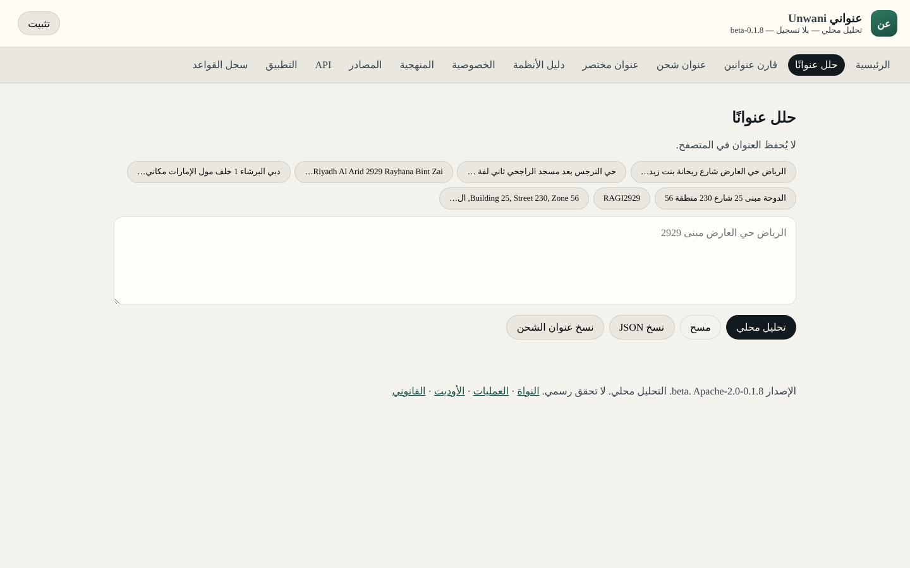
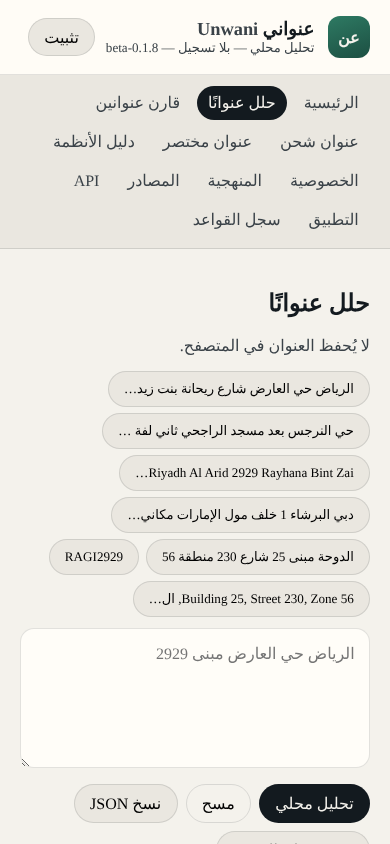

# 📍 عنواني · Unwani

**يحلل العناوين الخليجية المكتوبة بشكل حر ويحوّلها لحقول منظمة — داخل متصفحك، بلا تسجيل، وبلا إرسال النص لأي خادم.**

  
  
  
  
  

  
  

## ✨ وش يسوي

- تلصق عنوانًا مكتوبًا بأي صيغة (حي، شارع، رقم مبنى، رمز بريدي، العنوان المختصر…).
- يطلع لك الحقول مفصولة ومرتبة لمراجعتها ونسخها.
- يشتغل بدون إنترنت بعد أول فتح (تطبيق ويب تقدّمي).

## ⚠️ حدود صادقة

- التحليل **محلي وتقديري**، وليس تحققًا رسميًا من العنوان ولا مرتبطًا بأي جهة بريدية أو حكومية.
- راجع النتيجة دائمًا قبل الاعتماد عليها.

## 🗂️ عن هذا المستودع

هذا المستودع هو مضيف GitHub Pages للنسخة العامة. التطبيق الحي على:
**https://tmrsa1-ui.github.io/unwani/**

## 📄 الرخصة

[Apache-2.0](LICENSE) · [الأمان](SECURITY.md) · [سجل التغيير](CHANGELOG.md)

